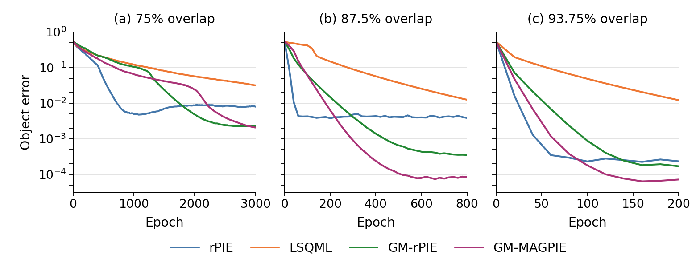
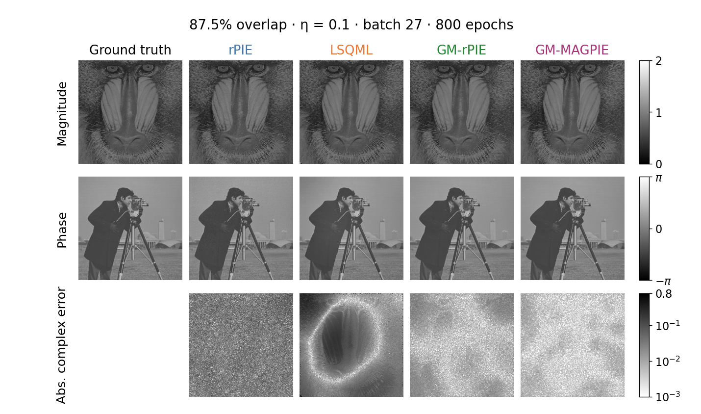

# MAGPIE for blind ptychography

Code and recorded results for [Stochastic Multigrid Method for Blind Ptychography](https://arxiv.org/abs/2511.01793), by Borong Zhang, Junjing Deng, Yi Jiang, and Zichao Wendy Di.

The experiments compare **rPIE, LSQML, GM-rPIE, and GM-MAGPIE** using [Pty-Chi](https://github.com/AdvancedPhotonSource/pty-chi) pinned to commit `9bff0739cc91b9ec58f49341429bd955a767389d`.

## Installation

Use Python 3.11:

```bash
python3.11 -m venv .venv
source .venv/bin/activate
python -m pip install --upgrade pip
python -m pip install -e ".[notebooks]"
jupyter lab
```

The nine [experiment notebooks](examples/README.md) inspect the included results on CPU. They default to `RUN_RECONSTRUCTIONS = False`. Full reconstruction reruns require an NVIDIA GPU and CUDA-enabled PyTorch.

## Experiments

| Study | Settings | Notebooks |
|---|---|---|
| Overlap parameter sweeps | 75% / 3,000 epochs; 87.5% / 800; 93.75% / 200; η=0.1; batch 27 | [Overlap](examples/overlap) |
| Noise | η=0.2 and 0.4 at all three overlaps; selected parameters and epoch budgets retained | [Noise](examples/noise) |
| Minibatch size | 87.5% overlap; η=0.1; batches 27, 108, 432; 800 epochs; parameters retuned at each size | [Batch](examples/batch/batch_0875.ipynb) |
| Real data | Test pattern and integrated circuit; four methods; 100 epochs | [Real data](examples/real) |

Synthetic data use a 1024 × 1024 object and a 128 × 128 probe. The object magnitude and phase come from the Baboon and Cameraman images. The true and initial probes use −700 µm and −400 µm defocus settings. Noise is generated by `d = η Poisson(d_tilde / η)`.

Each PIE method searches the nine pairs with both alphas in `[0.004, 0.02, 0.1]`. LSQML searches sixteen pairs: damping `[0.04, 0.1, 0.2, 1]` and σ `[0.3, 0.4, 0.5, 0.6]`. Selection uses the lowest **final object NMSE** for each method and condition. Noise tests retain the pair selected at η=0.1. Object error is evaluated after complex-scale and affine-phase alignment on the common scanned region.

The real-data experiments use 14,640 retained test-pattern measurements with batch 244, and 812 integrated-circuit measurements with batch 29. Scan positions are refined during reconstruction. Reconstruction quality is assessed from the object images; no ground-truth error is defined for these datasets.

## Included results

- [Result index](results/index.json): settings and file locations for every recorded case.
- [Overlap endpoints](results/overlap_endpoints.csv), [noise endpoints](results/noise_endpoints.csv), [batch endpoints](results/batch_endpoints.csv), and [real-data endpoints](results/real_endpoints.csv).
- [Selected cases](results/selected.csv), per-case configuration files, and convergence histories.
- [Paper figures](results/figures), the four selected 87.5% synthetic reconstruction arrays, and the eight real-data reconstruction arrays.

Shared baselines are referenced by the index rather than duplicated. The notebooks plot the archived object-error histories and display the corresponding paper figures. Synthetic measurement caches are generated during reruns; the original measured HDF5 inputs are obtained separately.



Object-error convergence at 75%, 87.5%, and 93.75% overlap using the selected parameter pairs.



Selected 87.5% object reconstructions: magnitude, phase, and logarithmic absolute complex error.

Verify the included files, parameter grids, selections, and reconstruction scores with:

```bash
python scripts/validate_results.py
```

## Repeating reconstructions

Install a CUDA-enabled PyTorch 2.11 / torchvision 0.26 build for your system, then install the reconstruction extra:

```bash
python -m pip install -e ".[notebooks,reconstruction]"
```

The reconstruction extra pins the recorded numerical package versions; [the environment record](provenance/environment.json) also identifies the original Python and CUDA versions.

Set `RUN_RECONSTRUCTIONS = True` in a notebook to run its study, or use the command line, for example:

```bash
python -m magpie_publication rerun --study overlap --overlap 0.875
python -m magpie_publication rerun --study real --dataset test_pattern
```

For real-data reruns, first supply the HDF5 files described in [the data instructions](assets/ptycho_real_data/README.md). Reruns write separate experiment outputs; the included publication records and figures remain the reference shown by the inspection cells.

## Repository layout

```text
src/          scientific runners and portable result helpers
examples/     nine notebooks for the recorded studies
assets/       synthetic inputs and measured-data instructions
provenance/   parameter selections and implementation identities
results/      endpoint records, histories, selected arrays, and paper figures
```

The code is distributed under the [MIT license](LICENSE). Please cite the paper when using the methods or these experiments.
